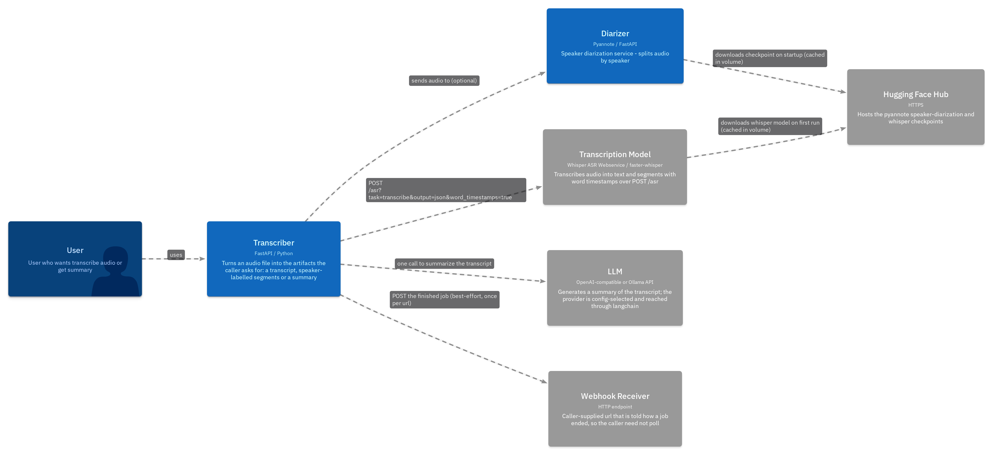
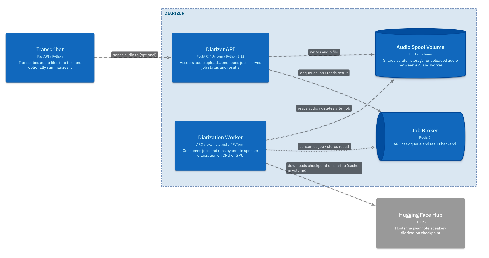
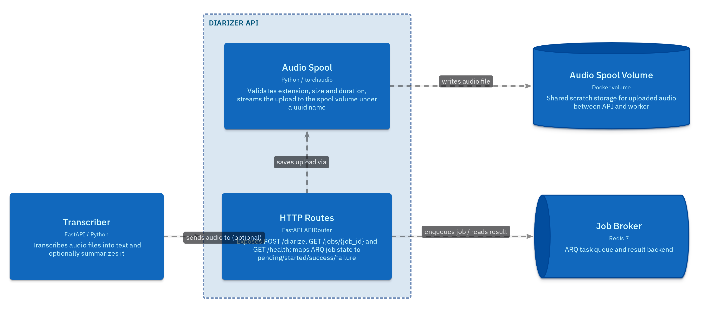
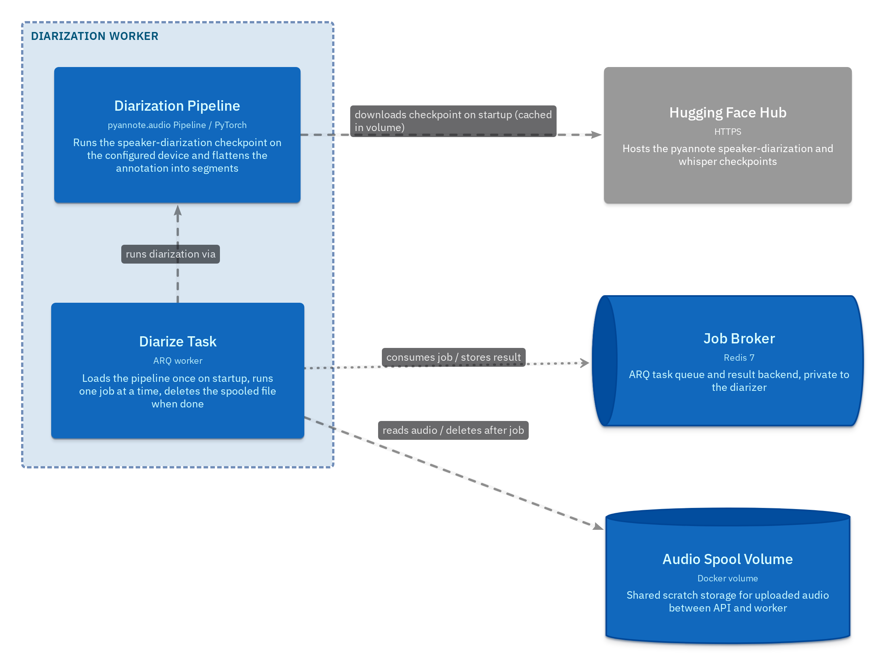
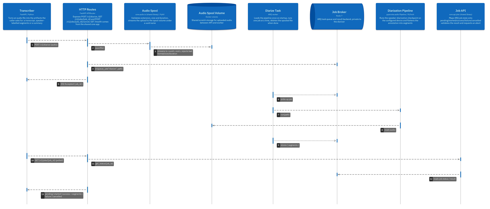
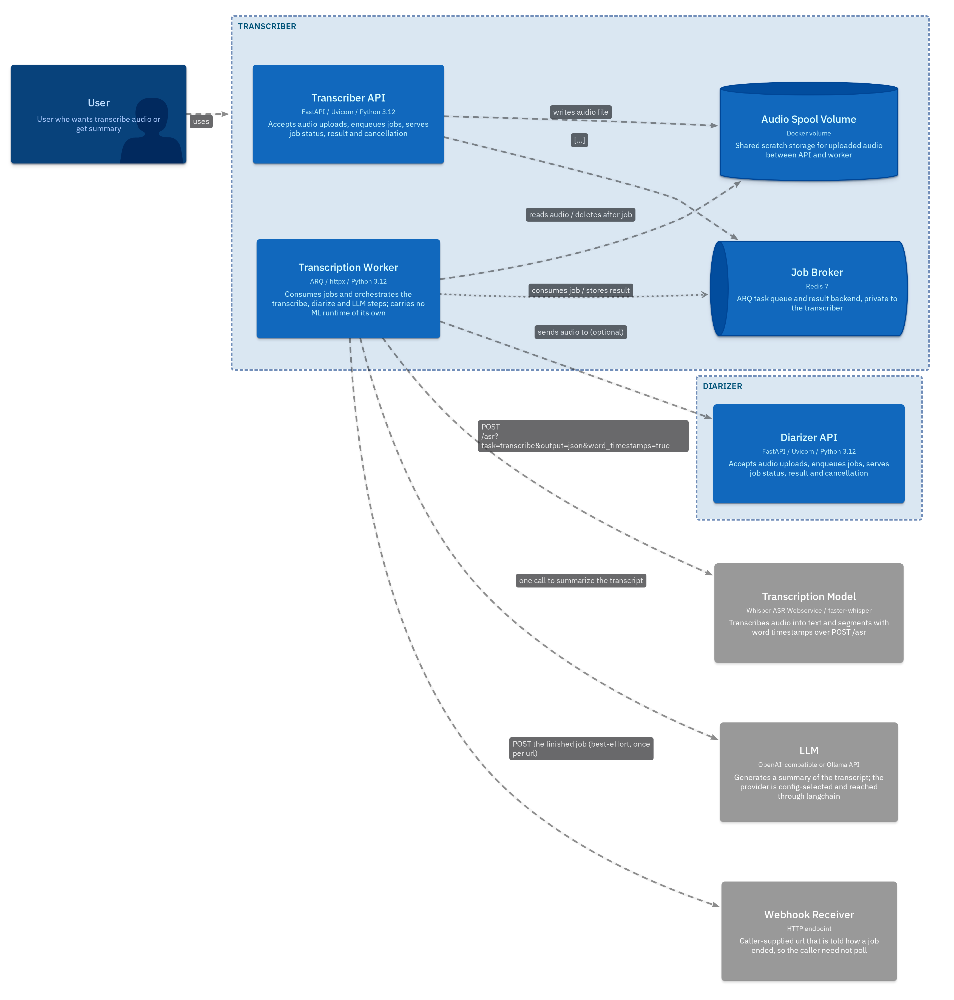
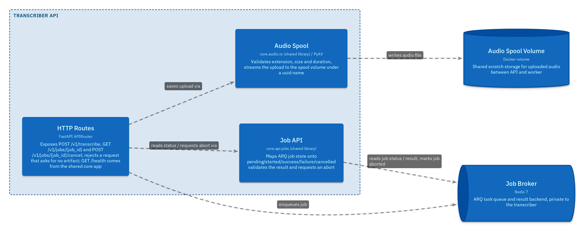
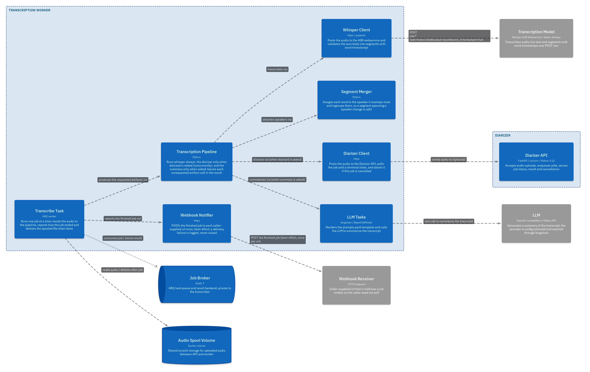
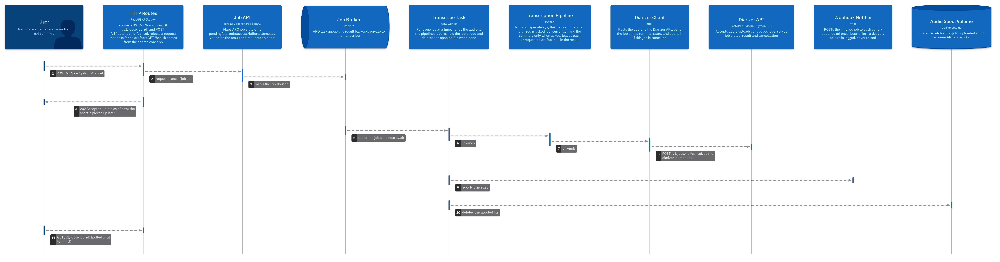

# ai-transcriber


Self-hosted service that turns a recording into text. You upload an audio or video file
and get back any mix of three things:

- `raw`: the Whisper transcript, split into timed segments
- `diarized`: the same segments, each tagged with a speaker
- `summary`: a meeting-style summary written by an LLM (TL;DR, topics, decisions, action items, open questions)

Under the hood it's faster-whisper for speech, pyannote for speakers, and any
OpenAI-compatible or Ollama model for the summary. Jobs run in the background on Redis
queues, so a four-hour call doesn't hold an HTTP connection open. There's also an MCP
server, so an AI agent can transcribe files on its own.

## Quick start

You need Docker with Compose and a Hugging Face token. The diarization model
([`pyannote/speaker-diarization-community-1`](https://huggingface.co/pyannote/speaker-diarization-community-1))
is gated, so accept its terms on Hugging Face first, or the diarizer won't be able to
download it.

```bash
git clone https://github.com/nedeadinside/ai-transcriber.git
cd ai-transcriber
cp .env.example .env   # fill in HF_TOKEN and LLM_API_KEY
docker compose up --build
```

The API comes up at `http://localhost:8000`, with Swagger at `/docs`. The first start is
slow: Whisper `large-v3` and the pyannote weights get downloaded into Docker volumes.
Later starts reuse them.

Got an NVIDIA GPU? Set `COMPOSE_PROFILES=gpu` in `.env`. The default `cpu` profile works
everywhere, just slower.

## Using the API

The flow is submit, then poll (or wait for a webhook), and cancel if you change your mind.

| Method | Path | What it does |
|---|---|---|
| `POST` | `/v1/transcribe` | Upload a file and queue a job |
| `GET` | `/v1/jobs/{id}` | Job status, plus the result once it's done |
| `POST` | `/v1/jobs/{id}/cancel` | Abort a job |

`/v1/transcribe` takes multipart form data: `file`, at least one of `raw`, `diarized`,
`summary` set to `true`, and optionally one or more `webhooks` URLs.

```bash
curl -F file=@meeting.mp4 -F diarized=true -F summary=true \
     http://localhost:8000/v1/transcribe
# {"job_id": "5f1c..."}

curl http://localhost:8000/v1/jobs/5f1c...
```

A job goes through `pending` → `started` → `success`, `failure` or `cancelled`. A finished
job looks like this:

```json
{
  "status": "success",
  "started_at": "2026-11-17T09:12:03Z",
  "duration_sec": 184.2,
  "result": {
    "raw": null,
    "diarized": [
      {"start": 0.0, "end": 4.3, "text": "Okay, let's start.", "speaker": "SPEAKER_00"}
    ],
    "summary": "**TL;DR** ..."
  }
}
```

Artifacts you didn't ask for come back as `null`. If you passed webhooks, each one gets a
single `POST` with the same body plus `job_id` when the job ends, whether it succeeded,
failed or was cancelled. A webhook that fails is logged and skipped. There are no retries.

### Supported files

Files up to 4 GB and 4 hours long. Every upload is converted to 16 kHz mono FLAC before
anything else happens. The conversion strategy depends on the file extension (see
`transcriber/src/pipeline/convert.py`). A file with no audio track gets a `400`, and one
over the size limit gets a `413`.

- Audio: `wav`, `mp3`, `m4a`, `flac`, `ogg`, `oga`, `opus`, `aac`, `wma`, `amr`, `aiff`, `aif`, `mka`, `caf`
- Video (only the audio track is used): `mp4`, `m4v`, `mov`, `mkv`, `webm`, `avi`, `wmv`, `flv`, `mpg`, `mpeg`, `ts`, `mts`, `3gp`

## MCP server

`mcp-server` lets AI agents use the transcriber over Streamable HTTP at
`http://localhost:8002/mcp`. It has one tool:

```
transcribe(path, raw=false, diarized=false, summary=false)
```

`path` points to a file in a shared pool directory, either absolute or relative to the pool
root. The tool queues the job, reports progress while it waits, and returns the artifacts
when the job finishes.

The pool is `POOL_DIR` from `.env`. It's mounted read-only into the container at the same
path on both sides. Mount whatever directory your agent saves uploads to there, and the
paths the agent sees will work inside the container as is. Paths that escape the pool are
rejected.

## Configuration

Three files, each with its own job:

- `.env`: ports, tokens, Docker images, the Whisper model and the cpu/gpu profile
- `config.yaml`: runtime settings for each service (queue concurrency, timeouts, upload limits, LLM provider and model, log level)
- `prompts.yaml`: the summary prompt. Edit it if you want a different summary format. The summary comes out in the language of the recording

To switch LLMs, change `transcriber.llm` in `config.yaml`. `provider` is `openai` (any
OpenAI-compatible endpoint, set via `params.base_url`) or `ollama`. The default points at
`gpt-oss:120b` on Ollama Cloud.

Default ports:

| Service | Port | Exposed |
|---|---|---|
| transcriber API | 8000 | yes |
| MCP server | 8002 | yes |
| diarizer API | 8001 | no, internal only |
| Whisper ASR | 9000 | no, internal only |

## How it fits together

```
client ──► transcriber-api ──► redis ──► transcriber-worker ──┬─► whisper-asr
   ▲                                                          ├─► diarizer-api ─► redis ─► diarizer-worker
   │                                                          └─► LLM
agent ──► mcp-server ──┘
```

Only the transcriber API and the MCP server face the outside. The transcriber worker
converts the file, then sends it to Whisper and, if speakers were requested, to the
diarizer at the same time. Speaker turns are matched to transcript segments by overlap.
If you ask for both `diarized` and `summary`, the LLM gets the speaker-labelled
transcript, so the summary can say who decided what. The diarizer is a separate service
with its own API, worker and Redis queue, which keeps the heavy pyannote model out of
the transcriber image.

Repository layout:

```
core/          shared code: config loading, job API helpers, audio I/O
transcriber/   public API and worker that runs the whole pipeline
diarizer/      internal speaker-diarization service (pyannote)
mcp-server/    MCP wrapper around the transcriber API
.docs/c4/      LikeC4 architecture model; the diagrams below are rendered from it
```

<details>
<summary><b>Architecture diagrams</b></summary>

### System context



### Containers: diarizer

The API accepts an upload and returns right away. The worker picks up the job separately,
and Redis holds both the job and its result.



### Components: diarizer API



### Components: diarization worker



### Flow: diarize an audio file



### Containers: transcriber



### Components: transcriber API



### Components: transcription worker



### Flow: transcribe an audio file


### Flow: cancel a job



</details>

## License

[WTFPL](LICENSE). Do what you want with it.
